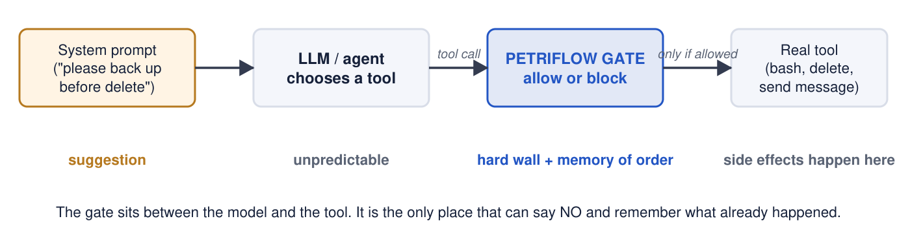
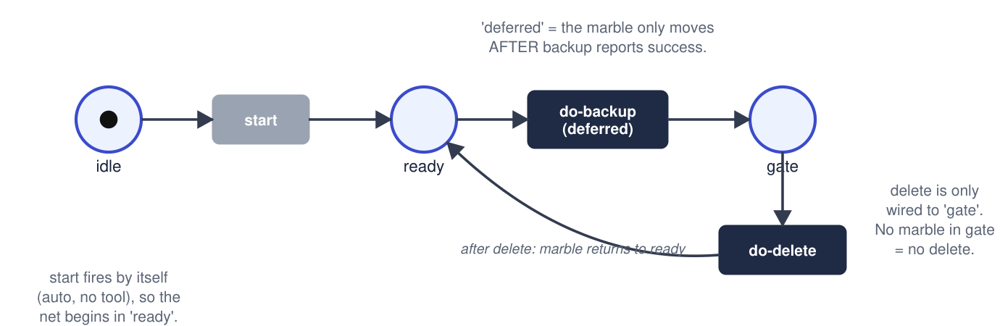
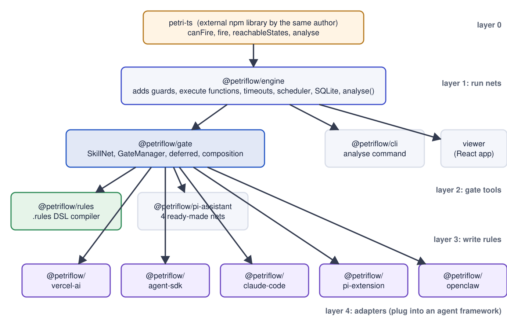
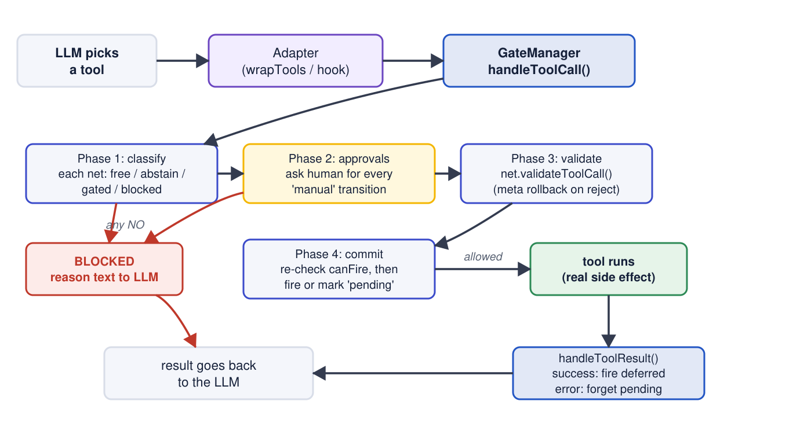
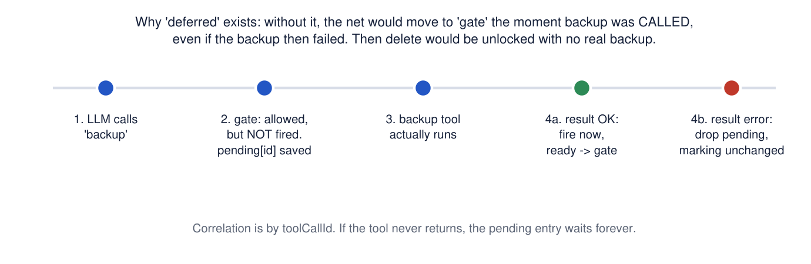
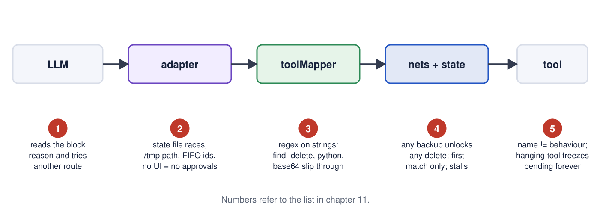

# ppp: a first-principles review of PetriFlow

Study material, runnable labs, validated loopholes, a 45-slide review deck and a research
position on self-evolving agents, all for the open-source project
[joshuaisaact/petri-flow](https://github.com/joshuaisaact/petri-flow) (MIT), a Petri-net
based tool gate for AI agents.

Everything here was produced by reading the source and running it (Windows 11, Bun 1.3.14,
8-10 October 2026). Every expected output in the text was captured from a real run. AI tools
assisted the reading; every claim was re-checked by hand against the named file or by
executing the command shown.

## How to use this repository

1. Read `docs/` in order (plain text, chapter per file). Chapters 1 to 8 are the review;
   chapters 10 to 13 are the four long guides as text.
2. Open `pdf/` for the same material with diagrams laid out (GitHub renders PDFs).
3. Open `ppt/PetriFlow_Review.pptx` (45 slides, 16:9, speaker notes inside), or copy
   `ppt/slides/SlideNN.PNG` into your own PowerPoint. `ppt/PetriFlow_Review_slides.txt`
   has every slide's text and notes.
4. Copy `labs/` into a clone of petri-flow and run the demos (commands below).
5. `diagrams/` holds the 45 diagrams as PNG for reuse.

## Contents

| Path | What |
|---|---|
| `docs/01-first-principles-summary.txt` | the problem, Petri nets from zero, rule templates |
| `docs/02-architecture-and-file-map.txt` | two products, dependency chain, every source file, one tool call end to end |
| `docs/03-website-vs-code.txt` | the docs site audited against the code; how to run its example on Azure OpenAI |
| `docs/04-is-the-mathematics-real.txt` | what is standard Petri-net theory here, what is missing, what the vocabulary means |
| `docs/05-loopholes-validated.txt` | 20 loopholes, ranked, each marked RUN (reproduced) or READ (source) |
| `docs/06-self-evolving-agents-research.txt` | 2025-2026 literature, where a static gate sits, research agenda R1-R8 |
| `docs/07-demo-script-90-minutes.txt` | agenda, nine demos, commands, expected output |
| `docs/08-real-run-and-commit-guide.txt` | real Azure run step by step, `labs/run-real.sh` to save the output, committing results to a company repo without leaking a credential |
| `docs/10..13-full-guide-*.txt` | the four long guides (concepts, tests and workflows, LLM labs, Azure setup) as text |
| `pdf/` | the same guides as PDFs, plus `PetriFlow_Review_Notes.pdf` (chapters 1-7 with diagrams) |
| `ppt/` | the deck, slide PNGs, slide text with speaker notes |
| `labs/` | `gate-playground.ts`, `loopholes.ts`, `run-real.sh` (runs everything, saves logs, redacts secrets), and `openai/` (five labs with MOCK / OpenAI / Azure modes) |
| `diagrams/` | 45 PNG diagrams |
| `research/sources.txt` | every URL used in chapter 6, with retrieval date |

## Run the demos (inside a petri-flow clone)

```bash
git clone https://github.com/joshuaisaact/petri-flow && cd petri-flow
bun install && bun run build                      # build first: tests import dist/
cp -r <this repo>/labs .                          # adds labs/ (not part of upstream)
bun add @ai-sdk/openai@^3 @ai-sdk/azure@^3 @azure/identity   # only for labs/openai

bun packages/cli/src/cli.ts analyse workflows/order-checkout/index.ts --strict   # demo 1
bun run labs/gate-playground.ts                                                  # demo 2
bun run labs/loopholes.ts                                                        # demo 7
MOCK=1 bun run labs/openai/01-file-agent.ts                                      # demo 4, no key
MOCK=1 bun run labs/openai/03-server.ts        # window 1
bun run labs/openai/03-spoof.ts                # window 2: forged history unlocks deploy (demo 6)

MOCK=1 bash labs/run-real.sh                   # all of the above in one go, saved under results/
bash labs/run-real.sh                          # same with the real model (chapter 8)
```

Real model: export `AZURE_OPENAI_ENDPOINT`, `AZURE_OPENAI_DEPLOYMENT`, `AZURE_TENANT_ID`,
`AZURE_CLIENT_ID`, `AZURE_CLIENT_SECRET` (service principal) and drop `MOCK=1`; or export
`OPENAI_API_KEY`. Details and troubleshooting: `docs/13-full-guide-azure-service-principal.txt`.

## The architecture in six diagrams

Where the rule lives:



A rule becomes a shape (`require A before B`, 3 reachable states):



Package layers (all the mathematics is in the external petri-ts library):



One tool call, four phases:



Deferred transitions: the net only believes success it has seen:



Where the loopholes sit:



## The verdict in five lines

- A real runtime tool gate: four-phase decision, deferred firing, AND composition, five adapters.
- Real but minimal mathematics: breadth-first reachability and invariant checking, all in a
  208-line external library; nothing symbolic; guards ignored by analysis.
- "Formally verified" on the website means "state count per rule". There is no `verify`
  command and no invariant check in the rules path.
- Six loopholes reproduced by running code; forged chat history unlocking a gated tool is a
  design consequence of a stateless gate.
- No self-evolution in the repo, by design. The 2025-2026 literature shows safety eroding
  exactly in the parts of agents that evolve, which is where a fixed, verifiable gate is
  needed, once composition analysis, a property language and evidence integrity exist.

## Verification status

Run on the authoring machine: all test suites (597 tests; 17 Windows-only failures with
known one-line fixes), all CLI analyses, the gate playground, the five-loophole script, the
forged-history demo against the mock server, all LLM labs in MOCK mode, the Azure
service-principal path up to Microsoft Entra with fake credentials. Not run on the authoring
machine: any call with real Azure credentials.

License of this material: MIT. PetriFlow itself is MIT, copyright Josh Tuddenham.
